# Technobot Rover

A two-wheel robot I built and debugged in Electronic Fabrication at Alfred State (Spring 2026). It started as a kit of bare circuit boards and loose components: I fabricated the whisker-sensor boards in-house, populated and soldered every board, built the sheet-metal chassis, and traced a power fault down to a single dead battery cell.

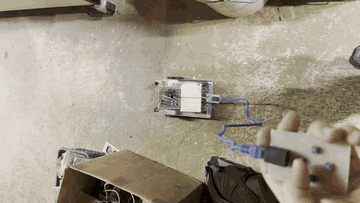

| Side | Top | Rear |
|---|---|---|
| 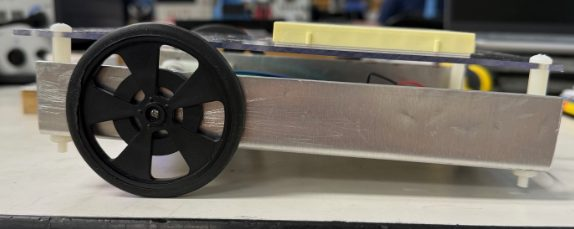 | 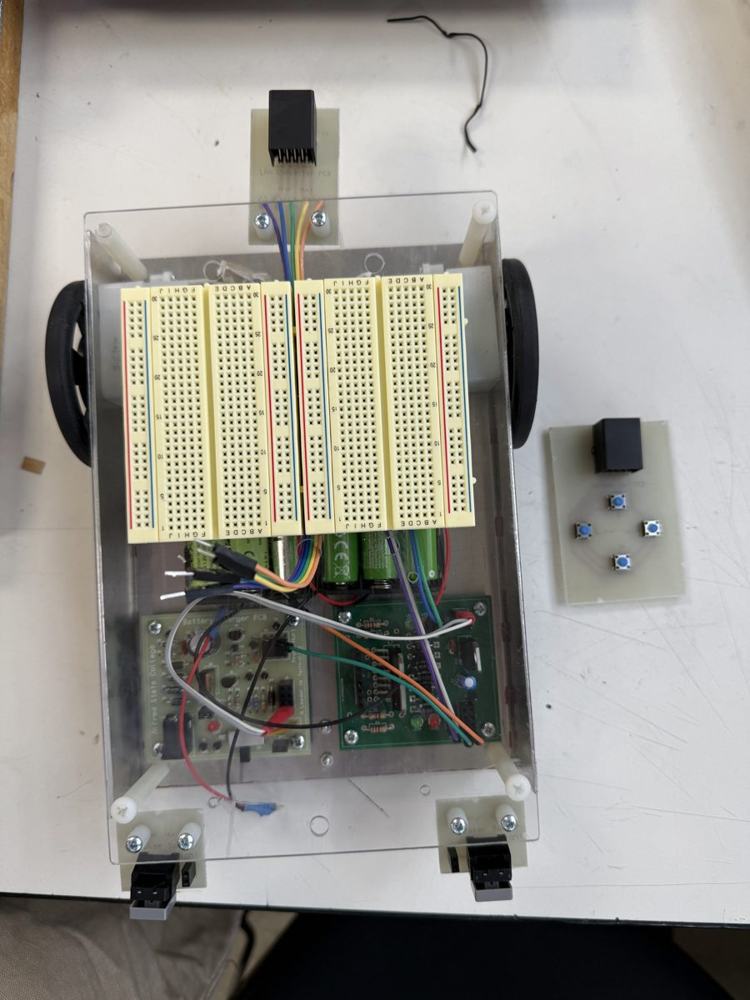 | 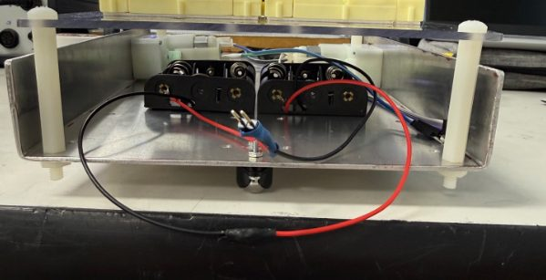 |

## What I did
- **Fabricated the whisker-sensor PCBs in-house** from a provided Ultiboard design: printed the layout onto toner-transfer paper, heat-transferred it to copper-clad board, chemically etched away the excess copper, and stripped the toner with acetone to reveal the traces
- **Drilled mounting holes** on a manual mill and **hand-soldered all components** on the pre-made controller, interface, motor and charger boards, including SMT parts placed with solder paste and reflow
- **Fabricated the chassis** from sheet metal
- **Tested and debugged** with a digital multimeter, oscilloscope and function generator

## How it's built
The robot runs from a 6-cell NiMH pack and is driven from a handheld controller over a tethered LAN cable.

| Board | Job |
|---|---|
| Controller + LAN connector | Handheld push-button controller, connected to the robot by a LAN cable |
| Interface | Reads the whisker sensors and drives the motor logic (LM555 timers, relays, NPN transistors) |
| Motor | Powers the two drive motors |
| Charger | Recharges the battery pack at a slow or fast rate (LM358 / LM431 regulation) |
| Whisker sensors (x2) | Bump sensors on the front corners; these are the boards I etched |

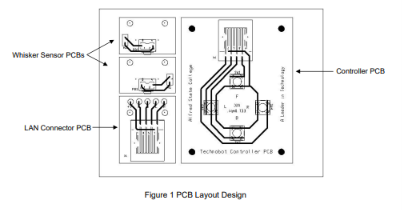

| Interface PCB | Motor PCB | Charger PCB |
|---|---|---|
| 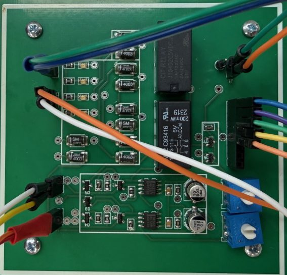 | 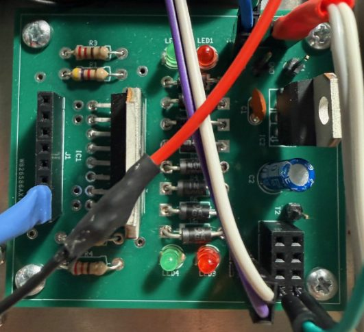 | 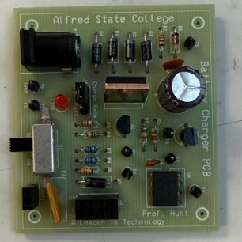 |

Whisker sensor layout in Ultiboard, and the interface board's parts kit before assembly:

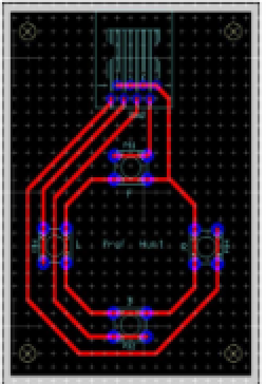 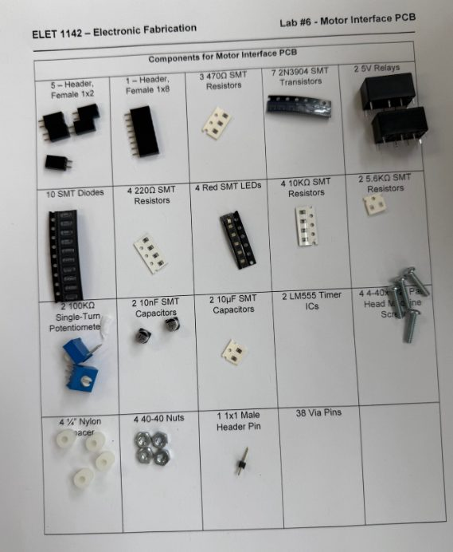

Battery charger schematic:

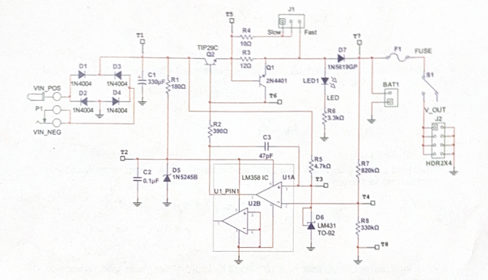

## Power budget
Measured with the pack installed:

| Measurement | Value |
|---|---|
| Pack voltage (6 x 1.2 V NiMH, nominal 7.2 V) | 7.81 V measured |
| Total robot current draw | 130 mA |
| Equivalent load resistance | 60.1 Ω |
| Estimated run time | 11.86 hours |
| Fast-charge current (measured) | 110 mA |
| Charge time | 6.89 hours |

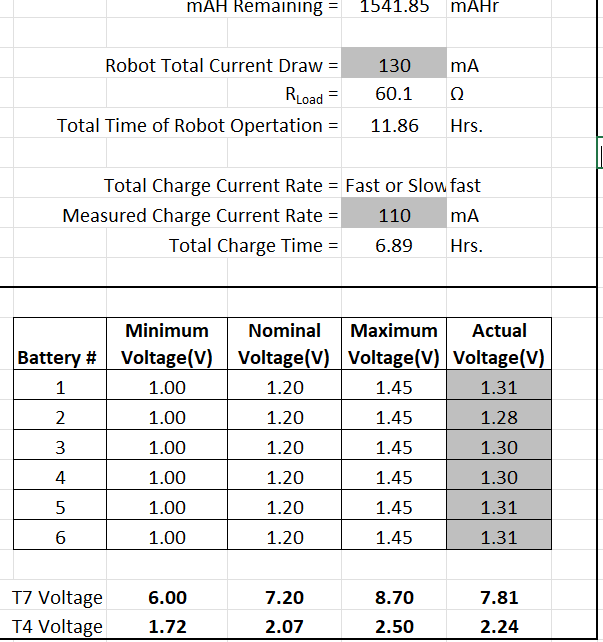

## Testing

| Bench test (wheels off) | Whisker test |
|---|---|
| 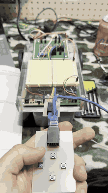 | 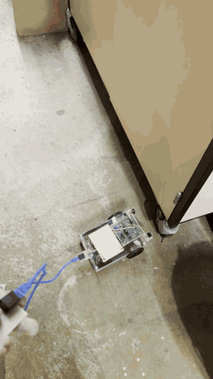 |

## Problem I hit and how I fixed it
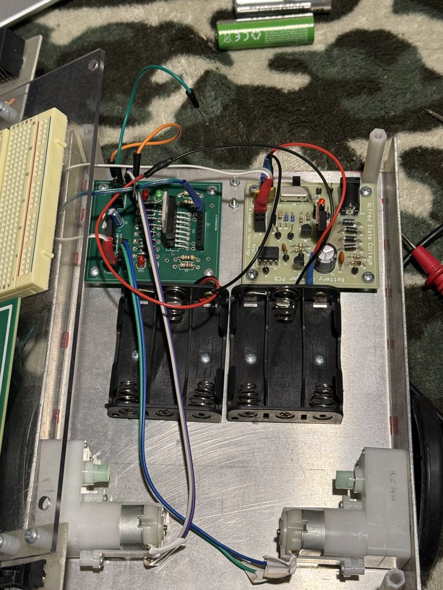

- **Symptom:** the motors stopped working and would only run while the charger was plugged in.
- **Diagnosis:** I probed every test point with a DMM and traced the fault to a dead cell in the battery pack, reading about 100 mV against a 1.2 V nominal.
- **Fix:** I replaced the cell and fully recharged the pack. I then went back and confirmed every reading across the motor and charger boards was in spec before running the robot again.

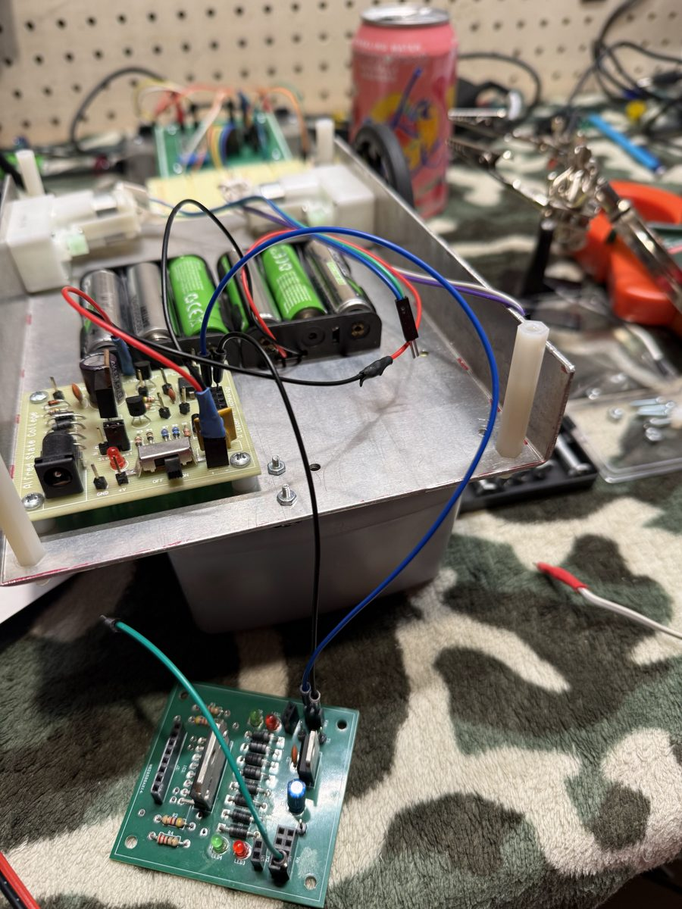

## Cost analysis
I priced the motor interface board from vendor catalogs: **$34.66 per board** at single-unit prices versus **$23.95** at bulk prices, about 31% less. That works out to $346.60 against $239.50 for a 10-board run.

Full bill of materials: [docs/interface_pcb_bom.md](docs/interface_pcb_bom.md)

## Upgrades in progress
- [ ] Wireless control with an IR receiver and remote, replacing the tethered cable
- [ ] Distance sensor so the rover detects obstacles before the whiskers hit them
- [ ] New motors and wheels
